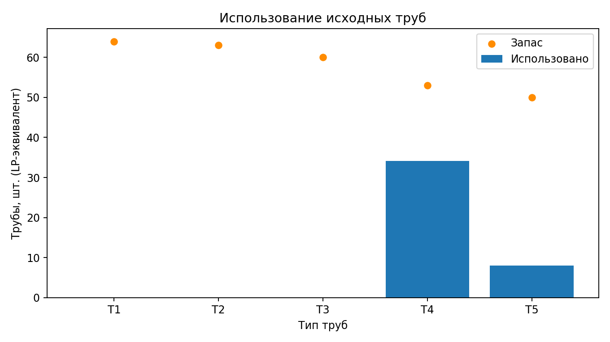
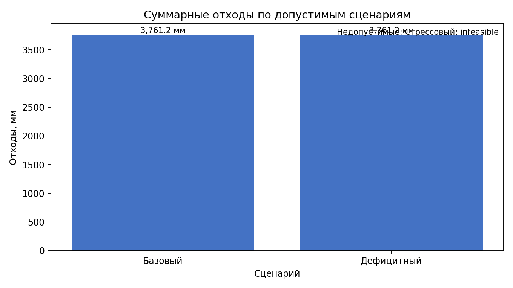
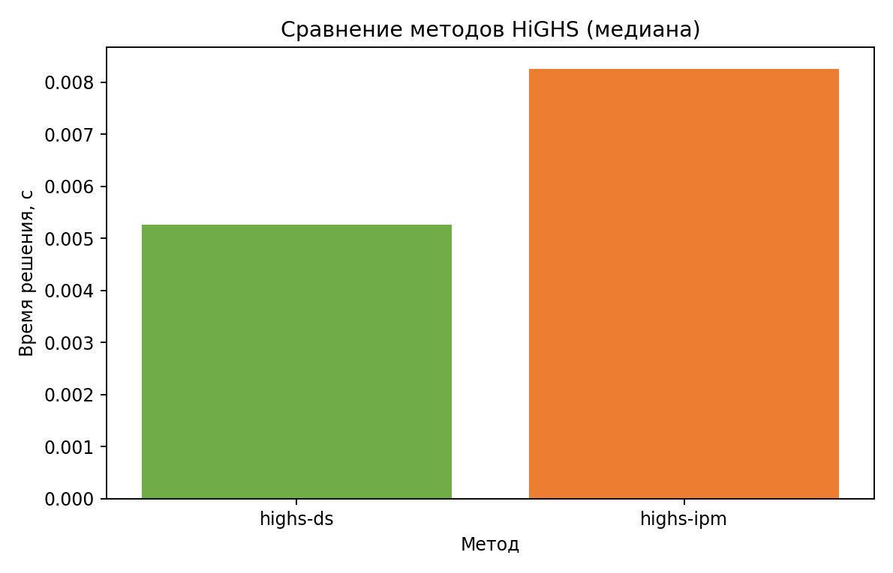

# Лабораторная работа №1 — линейное программирование

## 1. Титульная информация

**Дисциплина:** Методы оптимизации. Линейное программирование  
**Тема:** минимизация отходов при резке труб (усреднённая ЛП-постановка), вариант 19.  
Индивидуальные параметры: $N=5$, $Q=1$, $Y=26$, $V=19$, seed $=10105$. Проверка: $1+((17·5+7·1+26)\bmod20)=19$; $10000+100·1+5=10105$.  
Стек: Python 3.14.4, NumPy 2.3.3, Pandas 2.3.3, SciPy 1.16.2 `linprog` с HiGHS, Matplotlib 3.10.7.

## 2. Цель работы

Построить непрерывную LP-модель раскроя, найти план с минимальными суммарными остатками материала, независимо проверить ограничения и исследовать изменения условий.

## 3. Индивидуальное задание

Вариант 19: минимизация отходов при резке труб в усреднённой линейной постановке. План определяет схемы раскроя труб пяти типов для точного выполнения шести заказов.

## 4. Постановка задачи

Для каждого исходного типа имеется ограниченный запас. Каждая схема описывает целочисленную комбинацию отрезков, но количество труб, назначенное схеме, является непрерывным средним значением. Перепроизводство заказов запрещено.

## 5. Исходные данные

Данные сформированы единственным генератором `numpy.random.default_rng(10105)`: длины труб и заготовок равномерно выбирались в заданных диапазонах с шагом 10 мм, затем длины отсортированы; спрос генерировался целыми числами 18–50. Запасы назначены консервативно достаточными по суммарной длине спроса. Исходные CSV после создания сохраняются и при перезапусках не меняются.

### Типы труб

| pipe_id   |   length_mm |   stock_pcs |
|:----------|------------:|------------:|
| T1        |        6100 |          64 |
| T2        |        6220 |          63 |
| T3        |        6570 |          60 |
| T4        |        7450 |          53 |
| T5        |        7960 |          50 |

### Заказы

| order_id   |   length_mm |   demand_pcs |
|:-----------|------------:|-------------:|
| O1         |        1970 |           35 |
| O2         |        1810 |           42 |
| O3         |        1770 |           21 |
| O4         |        1730 |           41 |
| O5         |        1480 |           24 |
| O6         |        1420 |           18 |

## 6. Математическая модель

Множества: $I$ — типы труб; $J$ — заказы; $P_i$ — схемы для типа $i$; $P=\bigcup_iP_i$. Параметры: длина трубы $L_i$ (мм), запас $S_i$ (шт.), длина детали $l_j$ (мм), спрос $d_j$ (шт.), выпуск схемы $a_{jp}$ (дет.), отход $w_p$ (мм/трубу). Переменная $x_p\ge0$ — усреднённое количество труб, назначенных схеме.

$$\min Z=\sum_{p\in P}w_px_p$$

$$\sum_{p\in P}a_{jp}x_p=d_j\quad(j\in J),\qquad
\sum_{p\in P_i}x_p\le S_i\quad(i\in I),\qquad x_p\ge0.$$

Для схемы проверяется $\sum_j a_{jp}l_j\le L_i$, а $w_p=L_i-\sum_j a_{jp}l_j$. Пропил принят равным нулю; длины и отходы измеряются в мм, количества — в штуках.

## 7. Генерация схем раскроя

Алгоритм рекурсивно перебирает каждую допустимую комбинацию количества шести заказных отрезков и отсеивает пустые схемы. Верхние границы следуют из $a_{jp}\le\lfloor L_i/l_j\rfloor$, поэтому перечисление полное для заданных данных и ограничений производительности не вводилось. Получено **778** допустимых схем. Файл `data/generated/cutting_patterns.csv` содержит полный список. В плане используется следующее подмножество:

| pattern_id   | pipe_id   |   used_mm |   waste_mm |   x, труб |
|:-------------|:----------|----------:|-----------:|----------:|
| T4_P25       | T4        |      7410 |         40 |    1.7500 |
| T4_P46       | T4        |      7450 |          0 |    2.7500 |
| T4_P72       | T4        |      7000 |        450 |    1.6250 |
| T4_P187      | T4        |      7320 |        130 |   21.0000 |
| T4_P203      | T4        |      7440 |         10 |    7.0000 |
| T5_P74       | T5        |      7940 |         20 |    8.0000 |

## 8. Программная реализация

`data_generation.py` формирует исходники и метаданные; `data_loader.py` проверяет таблицы; `cutting_patterns.py` перечисляет схемы; `model.py` строит матрицы LP; `solver.py` запускает HiGHS и журналирует результаты; `validation.py` независимо пересчитывает баланс; `sensitivity.py` формирует двойственные оценки; `experiments.py` запускает сценарии и benchmark; `reporting.py` строит графики и данный отчёт. Главный сценарий — `run.py`.

## 9. Результаты базового сценария

Статус: **optimal**; целевая функция: **3761.250000 мм**; время: 0.015569 с; использовано труб (LP-эквивалент): 42.125000; доля отхода в использованном материале: 1.1831%. Запланированный раскрой приведён выше. Запас каждого типа проверяется отдельно; заказные балансы точны с учётом численной погрешности.

## 10. Независимая проверка

Проверены равенства выпуска по всем заказам, ограничения запасов каждого типа и неотрицательность. Допуск $\varepsilon=10^{-7}$. Максимальная невязка: 2.132e-14; самостоятельно пересчитанная цель: 3761.250000000 мм; отличие от результата HiGHS: 0.000e+00; проверка: **пройдена**. Пересчёт сделан непосредственно по CSV схем и вектору $x$, без матриц модели.

## 11. Дефицитный сценарий

Запас наиболее используемого в базовом плане типа **T4** уменьшен с 53.000 до 42.400 трубы (−20%; описание — `data/scenarios/shortage.json`). Статус: **optimal**; целевая функция: 3761.250000 мм; число использованных труб: 42.125000 трубы (LP-эквивалент). Изменение цели относительно базы: +0.000000 мм отходов относительно базы. План остался прежним, поскольку исходный запас этого типа превышал фактическое использование; сокращённый запас также остался выше потребности плана. Использование по типам:

| Тип трубы   |   Базовое использование, шт. |   После сокращения запаса, шт. |   Изменение, шт. |
|:------------|-----------------------------:|-------------------------------:|-----------------:|
| T1          |                       0.0000 |                         0.0000 |           0.0000 |
| T2          |                       0.0000 |                         0.0000 |           0.0000 |
| T3          |                       0.0000 |                         0.0000 |           0.0000 |
| T4          |                      34.1250 |                        34.1250 |           0.0000 |
| T5          |                       8.0000 |                         8.0000 |           0.0000 |

## 12. Стрессовый сценарий

Запас типа **T4** снижен ещё на 20% от исходного, спрос всех заказов увеличен в 12 раз (`data/scenarios/stress.json`). Статус HiGHS: **infeasible**; значение целевой функции: не рассчитывается (модель недопустима). Совокупный доступный запас материала составляет 1,890,340 мм, тогда как суммарная длина требуемых деталей равна 3,769,800 мм. Уже необходимая длина деталей превышает доступный материал, поэтому точное выполнение спроса физически невозможно. SciPy-интерфейс не предоставляет здесь IIS, и он не заявляется.

## 13. Анализ теневых цен

SciPy возвращает маргиналы по правым частям; в таблице они измеряются в мм изменения отхода на единицу спроса или запаса. Для равенств это производная цели по спросу, для верхних границ — по запасу (неположительная при минимизации). Нулевая оценка запаса означает отсутствие локальной ценности дополнительной трубы в текущем базисе. Все ограничения запасов неактивны. Например, маргинал заказа demand_O4 равен 132.500: увеличение спроса на одну деталь увеличило цель на 132.500 мм. Для demand_O1 маргинал -107.500, и добавление одной детали уменьшило суммарный отход на 107.500 мм, поскольку схема лучше заполняет длину труб. Для обеих проверок фактическое изменение совпало с локальным прогнозом. Такие оценки применимы только пока базис не меняется.

| constraint   | type              |   rhs |     lhs |   slack | active   |   shadow_price | rhs_change_convention                    |
|:-------------|:------------------|------:|--------:|--------:|:---------|---------------:|:-----------------------------------------|
| demand_O1    | demand equality   |    35 | 35.0000 |  0.0000 | True     |      -107.5000 | objective change ≈ marginal × RHS change |
| demand_O2    | demand equality   |    42 | 42.0000 |  0.0000 | True     |        52.5000 | objective change ≈ marginal × RHS change |
| demand_O3    | demand equality   |    21 | 21.0000 |  0.0000 | True     |        92.5000 | objective change ≈ marginal × RHS change |
| demand_O4    | demand equality   |    41 | 41.0000 | -0.0000 | True     |       132.5000 | objective change ≈ marginal × RHS change |
| demand_O5    | demand equality   |    24 | 24.0000 | -0.0000 | True     |       -68.3333 | objective change ≈ marginal × RHS change |
| demand_O6    | demand equality   |    18 | 18.0000 |  0.0000 | True     |       -23.1250 | objective change ≈ marginal × RHS change |
| stock_T1     | stock upper bound |    64 |  0.0000 | 64.0000 | False    |        -0.0000 | objective change ≈ marginal × RHS change |
| stock_T2     | stock upper bound |    63 |  0.0000 | 63.0000 | False    |        -0.0000 | objective change ≈ marginal × RHS change |
| stock_T3     | stock upper bound |    60 |  0.0000 | 60.0000 | False    |        -0.0000 | objective change ≈ marginal × RHS change |
| stock_T4     | stock upper bound |    53 | 34.1250 | 18.8750 | False    |        -0.0000 | objective change ≈ marginal × RHS change |
| stock_T5     | stock upper bound |    50 |  8.0000 | 42.0000 | False    |        -0.0000 | objective change ≈ marginal × RHS change |

Проверка прогноза для увеличения спроса каждого заказа на одну деталь:

| constraint   |   rhs_delta |   shadow_price |   predicted_delta |   actual_delta |   absolute_error | status   |
|:-------------|------------:|---------------:|------------------:|---------------:|-----------------:|:---------|
| demand_O1    |           1 |      -107.5000 |         -107.5000 |      -107.5000 |           0.0000 | optimal  |
| demand_O2    |           1 |        52.5000 |           52.5000 |        52.5000 |           0.0000 | optimal  |
| demand_O3    |           1 |        92.5000 |           92.5000 |        92.5000 |           0.0000 | optimal  |
| demand_O4    |           1 |       132.5000 |          132.5000 |       132.5000 |           0.0000 | optimal  |
| demand_O5    |           1 |       -68.3333 |          -68.3333 |       -68.3333 |           0.0000 | optimal  |
| demand_O6    |           1 |       -23.1250 |          -23.1250 |       -23.1250 |           0.0000 | optimal  |

## 14. Дополнительное задание: сравнение решателей

Сравнивались `highs-ds` (dual simplex) и `highs-ipm` на одинаковой модели, с семью повторениями; измерялось только решение подготовленной LP. Итерации берутся из `OptimizeResult.nit`, если SciPy их предоставил. Сводка медиан:

| method    |   time_seconds |   iterations |   objective |
|:----------|---------------:|-------------:|------------:|
| highs-ds  |         0.0053 |           11 |   3761.2500 |
| highs-ipm |         0.0083 |           15 |   3761.2500 |

Оба метода получили одинаковую цель 3761.250000 мм. `highs-ds` быстрее: медиана 0.005263 с против 0.008255 с (1.57×); итераций 11 против 15. На небольшой задаче абсолютные времена чувствительны к системной нагрузке и внутренним накладным расходам; вывод основан на семи повторениях и их медианах.

## 15. Анализ результатов

Сценарий снижения запаса на 20% не повлиял на оптимальный план: использовано 34.125 трубы типа T4 при доступных 42.4, и цель сохранилась на уровне 3761.25 мм. Это согласуется с нулевой теневой ценой неактивного ограничения запаса T4. Стрессовый сценарий недопустим, потому что требуемая длина деталей 3,769,800 мм больше суммарной длины доступного сырья 1,890,340 мм. В benchmark обе стратегии нашли одинаковую цель; для этой небольшой задачи dual simplex оказался быстрее. Локальные ценовые прогнозы подтвердились малыми изменениями спроса; при крупных изменениях может меняться базис.

## 16. Вывод

Построена и решена усреднённая LP-модель с точным выполнением спроса, ограниченным запасом и минимизацией остатков. Схемы перечислены исчерпывающе для заданных длин, базовое решение проверено независимым пересчётом. Теневые цены и сценарные прогоны показывают, как доступность материала и структура заказа влияют на стоимость раскроя.

## 17. Ограничения модели

Переменные $x_p$ непрерывны, потому что постановка описывает усреднённый поток повторяющихся операций, а не единичный физический запуск. Поэтому результат может содержать дробное число труб: например, 2.4 трубы одной схемы означает долю/среднее по серии планов. Для агрегированного анализа это допустимо и сохраняет линейность. Исполнение конкретной смены может потребовать целочисленной модели. Не учитываются пропил, дефекты, переналадка, ограничения станка, очередность резов, совместимость материалов, упаковка и стоимость разных типов труб.

## 18. Запуск

Из корня проекта: `python -m pip install -r requirements.txt`; затем `cd lr-1 && python run.py`. Python 3.11–3.14; точные версии зависимостей закреплены в requirements-файлах. Отчёт: `reports/report.md`.
