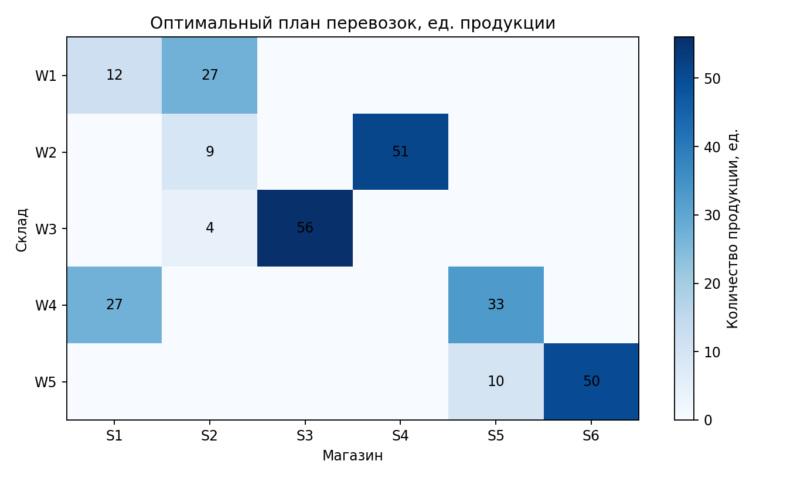
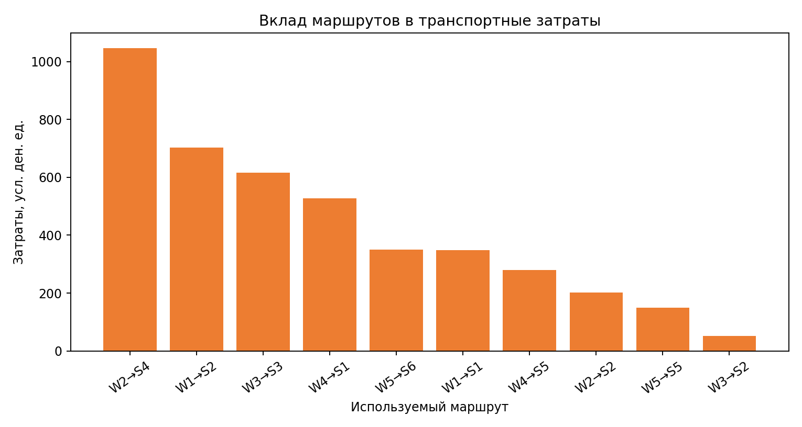
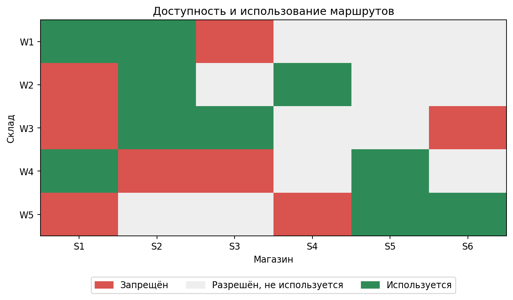
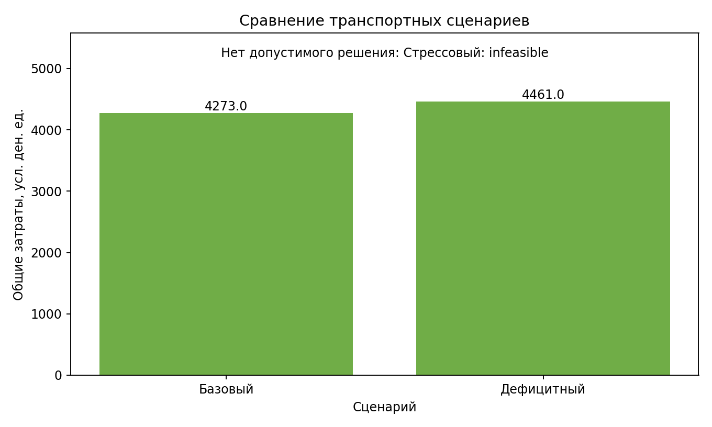

# Лабораторная работа №2 — транспортная задача

## 1. Титульная информация

**Дисциплина:** Методы оптимизации. Линейное программирование  
**Тема:** оптимальное распределение продукции при запрете части маршрутов.  
**Группа:** 517; **вариант:** 19.  
**Технологии фактического запуска:** Python 3.14.4, NumPy 2.3.3, Pandas 2.3.3, SciPy 1.16.2, HiGHS 1.8.0 через `scipy.optimize.linprog`, Matplotlib 3.10.7.

## 2. Цель работы

Построить транспортную LP-модель с явным исключением запрещённых маршрутов, минимизировать стоимость доставки, проверить решение независимым расчётом и изучить влияние ограничений и сценарных изменений.

## 3. Индивидуальный вариант

Использованы $N=5$, $Q=1$, $Y=26$, группа 517, seed 10105.  
$$V=1+((17N+7Q+Y)\bmod 20)=1+((17\cdot5+7\cdot1+26)\bmod20)=19.$$

Вариант 19: транспортная задача с запретом части маршрутов.

## 4. Постановка задачи

Пять складов отправляют продукцию шести магазинам. Для каждого склада известен запас в единицах продукции, для каждого магазина — точный спрос. У каждой пары «склад–магазин» есть положительная стоимость доставки одной единицы, но часть дуг закрыта. Запрещённые пары не получают переменных в LP и в сохранённом плане имеют нулевой поток.

## 5. Математическая модель

Пусть $I$ — склады, $J$ — магазины, $A\subseteq I\times J$ — разрешённые маршруты. Параметры: $s_i$ — запас (ед. продукции), $d_j$ — спрос (ед. продукции), $c_{ij}$ — стоимость единицы по маршруту (условные денежные единицы/ед.). Переменная $x_{ij}\ge0$ — объём поставки по разрешённому маршруту (ед.).

$$\min Z=\sum_{(i,j)\in A}c_{ij}x_{ij}$$

$$\sum_{j:(i,j)\in A}x_{ij}\le s_i\quad(i\in I),\qquad
\sum_{i:(i,j)\in A}x_{ij}=d_j\quad(j\in J),\qquad x_{ij}\ge0.$$

Переменные создаются только для $A$. Это агрегированная потоковая модель регулярных поставок; непрерывные значения представляют средний объём за период. Для единичных неделимых отправок требовалась бы целочисленная постановка. Запрет не моделируется большой стоимостью: конечный штраф может оказаться выгоднее других маршрутов и потому не гарантирует нулевой поток.

## 6. Генерация данных

Использован `numpy.random.default_rng(10105)`. Спрос магазинов равномерно генерировался целыми числами 38–60. Разрешённость маршрутов выбиралась с вероятностью 0.50, затем добавлялся связный backbone $W_i\to S_i,S_{i+1}$; при необходимости каждому магазину обеспечивалось не менее двух входящих дуг. Стоимости генерировались в диапазоне 7–30 с дополнительной индексной составляющей расстояния. Начальные запасы равномерно заданы как $\lceil\sum_jd_j/|I|\rceil+4$; при необходимости мощности увеличивались, пока сеть не становилась допустимой. Перед сохранением отдельная LP-проверка HiGHS удостоверяет выполнимость по реальным разрешённым дугам. Исходные CSV при повторных запусках не меняются.

### Склады

| warehouse_id   | warehouse_name   |   supply |
|:---------------|:-----------------|---------:|
| W1             | Склад 1          |       60 |
| W2             | Склад 2          |       60 |
| W3             | Склад 3          |       60 |
| W4             | Склад 4          |       60 |
| W5             | Склад 5          |       60 |

### Магазины

| store_id   | store_name   |   demand |
|:-----------|:-------------|---------:|
| S1         | Магазин 1    |       39 |
| S2         | Магазин 2    |       40 |
| S3         | Магазин 3    |       56 |
| S4         | Магазин 4    |       51 |
| S5         | Магазин 5    |       43 |
| S6         | Магазин 6    |       50 |

### Примеры транспортных затрат (первые 12 пар)

| warehouse_id   | store_id   |   unit_cost |
|:---------------|:-----------|------------:|
| W1             | S1         |      29.000 |
| W1             | S2         |      26.000 |
| W1             | S3         |      12.000 |
| W1             | S4         |      29.000 |
| W1             | S5         |      20.000 |
| W1             | S6         |      23.000 |
| W2             | S1         |      21.500 |
| W2             | S2         |      22.500 |
| W2             | S3         |      24.500 |
| W2             | S4         |      20.500 |
| W2             | S5         |      15.500 |
| W2             | S6         |      33.500 |

## 7. Программная реализация

`data_generation.py` создаёт данные и проверяет выполнимость; `data_loader.py` проверяет таблицы и ключи; `model.py` строит матрицы только по разрешённым маршрутам; `solver.py` вызывает HiGHS; `validation.py` независимо пересчитывает сохранённый план; `sensitivity.py` разбирает маргиналы и проверяет их возмущениями RHS; `experiments.py` выполняет сценарии и анализ дуг; `reporting.py` формирует графики и этот отчёт; `run.py` управляет запуском. Для $n_A$ разрешённых маршрутов модель содержит ровно $n_A$ переменных.

## 8. Настройки решателя

Решатель — HiGHS из SciPy, `scipy.optimize.linprog(method="highs")`; переменные ограничены снизу нулём, для запасов заданы `A_ub x <= b_ub`, спрос представлен `A_eq x = b_eq`. Явные настройки tolerances не переопределялись: используются значения SciPy/HiGHS по умолчанию. Статусы SciPy: 0 — оптимум; 1 — лимит; 2 — несовместность; 3 — неограниченность; 4 — ошибка решателя. Численные данные среды записаны в `data/generated/generation_metadata.json`.

## 9. Результаты базового сценария

Статус: **optimal**; оптимальные транспортные затраты: **4273.000000** условных денежных единиц; время решения 0.003429 с; итерации: 10. Отправлено 279.000 из 300.000 единиц, совокупный спрос — 279.000 единиц. Использовано 10 из 22 разрешённых маршрутов.

### План всех потенциальных маршрутов

| warehouse_id   | store_id   |   allowed |   unit_cost |   quantity |   total_cost |
|:---------------|:-----------|----------:|------------:|-----------:|-------------:|
| W1             | S1         |         1 |      29.000 |     12.000 |      348.000 |
| W1             | S2         |         1 |      26.000 |     27.000 |      702.000 |
| W1             | S3         |         0 |      12.000 |      0.000 |        0.000 |
| W1             | S4         |         1 |      29.000 |      0.000 |        0.000 |
| W1             | S5         |         1 |      20.000 |      0.000 |        0.000 |
| W1             | S6         |         1 |      23.000 |      0.000 |        0.000 |
| W2             | S1         |         0 |      21.500 |      0.000 |        0.000 |
| W2             | S2         |         1 |      22.500 |      9.000 |      202.500 |
| W2             | S3         |         1 |      24.500 |      0.000 |        0.000 |
| W2             | S4         |         1 |      20.500 |     51.000 |     1045.500 |
| W2             | S5         |         1 |      15.500 |      0.000 |        0.000 |
| W2             | S6         |         1 |      33.500 |      0.000 |        0.000 |
| W3             | S1         |         0 |      25.000 |      0.000 |        0.000 |
| W3             | S2         |         1 |      13.000 |      4.000 |       52.000 |
| W3             | S3         |         1 |      11.000 |     56.000 |      616.000 |
| W3             | S4         |         1 |      28.000 |      0.000 |        0.000 |
| W3             | S5         |         1 |      12.000 |      0.000 |        0.000 |
| W3             | S6         |         0 |      25.000 |      0.000 |        0.000 |
| W4             | S1         |         1 |      19.500 |     27.000 |      526.500 |
| W4             | S2         |         0 |      29.500 |      0.000 |        0.000 |
| W4             | S3         |         0 |      21.500 |      0.000 |        0.000 |
| W4             | S4         |         1 |      18.500 |      0.000 |        0.000 |
| W4             | S5         |         1 |       8.500 |     33.000 |      280.500 |
| W4             | S6         |         1 |      11.500 |      0.000 |        0.000 |
| W5             | S1         |         0 |      38.000 |      0.000 |        0.000 |
| W5             | S2         |         1 |      38.000 |      0.000 |        0.000 |
| W5             | S3         |         1 |      28.000 |      0.000 |        0.000 |
| W5             | S4         |         0 |      22.000 |      0.000 |        0.000 |
| W5             | S5         |         1 |      15.000 |     10.000 |      150.000 |
| W5             | S6         |         1 |       7.000 |     50.000 |      350.000 |

### Использование складов

| warehouse_id   |   supply |   shipped |   unused |
|:---------------|---------:|----------:|---------:|
| W1             |       60 |    39.000 |   21.000 |
| W2             |       60 |    60.000 |    0.000 |
| W3             |       60 |    60.000 |    0.000 |
| W4             |       60 |    60.000 |    0.000 |
| W5             |       60 |    60.000 |    0.000 |

### Обслуживание магазинов

| store_id   |   demand |   received |   difference |
|:-----------|---------:|-----------:|-------------:|
| S1         |       39 |     39.000 |        0.000 |
| S2         |       40 |     40.000 |        0.000 |
| S3         |       56 |     56.000 |        0.000 |
| S4         |       51 |     51.000 |        0.000 |
| S5         |       43 |     43.000 |        0.000 |
| S6         |       50 |     50.000 |        0.000 |

Самые затратные использованные маршруты:

| warehouse_id   | store_id   |   quantity |   unit_cost |   total_cost |   share_of_total_transport_cost |
|:---------------|:-----------|-----------:|------------:|-------------:|--------------------------------:|
| W2             | S4         |     51.000 |      20.500 |     1045.500 |                           0.245 |
| W1             | S2         |     27.000 |      26.000 |      702.000 |                           0.164 |
| W3             | S3         |     56.000 |      11.000 |      616.000 |                           0.144 |
| W4             | S1         |     27.000 |      19.500 |      526.500 |                           0.123 |
| W5             | S6         |     50.000 |       7.000 |      350.000 |                           0.082 |

## 10. Независимая проверка

Проверяющий модуль повторно загружает сохранённый `transportation_plan.csv` и CSV исходных данных. Независимо пересчитаны отгрузки каждого склада, поступления каждому магазину, остатки, запрещённые дуги, неотрицательность и цель. Допуск $10^{-7}$. Проверка: **пройдена**; максимальная невязка 0.000e+00; пересчитанная цель 4273.000000000; расхождение с HiGHS 0.000e+00.

| check                   |      lhs |      rhs |   residual | passed   |
|:------------------------|---------:|---------:|-----------:|:---------|
| supply_W1               |   39.000 |   60.000 |      0.000 | True     |
| supply_W2               |   60.000 |   60.000 |      0.000 | True     |
| supply_W3               |   60.000 |   60.000 |      0.000 | True     |
| supply_W4               |   60.000 |   60.000 |      0.000 | True     |
| supply_W5               |   60.000 |   60.000 |      0.000 | True     |
| demand_S1               |   39.000 |   39.000 |      0.000 | True     |
| demand_S2               |   40.000 |   40.000 |      0.000 | True     |
| demand_S3               |   56.000 |   56.000 |      0.000 | True     |
| demand_S4               |   51.000 |   51.000 |      0.000 | True     |
| demand_S5               |   43.000 |   43.000 |      0.000 | True     |
| demand_S6               |   50.000 |   50.000 |      0.000 | True     |
| nonnegativity           |    0.000 |    0.000 |      0.000 | True     |
| forbidden_routes_unused |    0.000 |    0.000 |      0.000 | True     |
| objective_recalculation | 4273.000 | 4273.000 |      0.000 | True     |

## 11. Анализ запрещённых маршрутов

Всего пар: **30**, разрешено **22**, запрещено **8** (26.7%). Запреты являются структурными: поток по ним не входит в вектор решения. Разрешённость и использование отмечены на карте.

Число доступных связей по складам:

| warehouse_id   |   allowed_routes |
|:---------------|-----------------:|
| W1             |                5 |
| W2             |                5 |
| W3             |                4 |
| W4             |                4 |
| W5             |                4 |

Число доступных связей по магазинам:

| store_id   |   allowed_routes |
|:-----------|-----------------:|
| S1         |                2 |
| S2         |                4 |
| S3         |                3 |
| S4         |                4 |
| S5         |                5 |
| S6         |                4 |

Без запретов стоимость равна 3760.000000; с запретами — 4273.000000. Разница стоимости от ограничения дуг: +513.000000 (+13.64%). Это сравнение сохраняется отдельно от трёх основных сценариев.

## 12. Сценарные эксперименты

Сводные статусы, цели, запасы, спрос, использованный ресурс, число активных маршрутов и время приведены в таблице ниже.

| scenario   | solver_status   | objective_value   |   total_supply |   total_demand | used_supply   | unused_supply   |   number_of_allowed_routes | number_of_used_routes   |   solve_time | independent_validation_passed   |
|:-----------|:----------------|:------------------|---------------:|---------------:|:--------------|:----------------|---------------------------:|:------------------------|-------------:|:--------------------------------|
| baseline   | optimal         | 4273.0            |        300.000 |        279.000 | 279.0         | 21.0            |                         22 | 10.0                    |        0.003 | True                            |
| shortage   | optimal         | 4461.0            |        288.000 |        279.000 | 279.0         | 9.0             |                         22 | 10.0                    |        0.002 | True                            |
| stress     | infeasible      | —                 |        264.000 |        300.400 | —             | —               |                         21 | —                       |        0.002 | —                               |

**Дефицитный сценарий.** Сокращён запас склада W3 на 20% (60.000 → 48.000). Статус: optimal; изменение стоимости относительно базы: +188.000000 условных денежных единиц. Потоки по изменившимся связям:

| warehouse_id   | store_id   |   quantity_baseline |   quantity_shortage |   change |
|:---------------|:-----------|--------------------:|--------------------:|---------:|
| W1             | S2         |              27.000 |              39.000 |   12.000 |
| W2             | S2         |               9.000 |               1.000 |   -8.000 |
| W2             | S3         |               0.000 |               8.000 |    8.000 |
| W3             | S3         |              56.000 |              48.000 |   -8.000 |
| W3             | S2         |               4.000 |               0.000 |   -4.000 |

В JSON сохранена точно применённая корректировка.

**Стрессовый сценарий.** Одновременно запас двух активно используемых складов сокращён на 30%, спрос двух магазинов увеличен на 20%, а один ранее разрешённый использованный маршрут запрещён. Потеря запаса 36.000 единиц, прирост спроса 21.400 единиц. Статус: **infeasible**; целевая функция не приводится при отсутствии оптимального решения. Совокупный запас 264.000 меньше спроса 300.400 на 36.400 единиц, что само по себе объясняет infeasible. Магазин S3 теряет связь со складом W3: доступных входов было 3, осталось 2; полной изоляции нет.

## 13. Анализ теневых цен

HiGHS возвращает маргиналы RHS. Для склада передано $A_{ub}x\le s$, поэтому marginal обычно неположителен: увеличение запаса меняет минимум приблизительно на `marginal × Δs`. Для спроса задано равенство, и маргинал показывает изменение минимума при увеличении точного спроса. Неактивные ограничения с нулевым маргиналом локальной ценности не имеют.

| constraint_type   | entity_id   |   marginal |   slack | active   | interpretation                                                                          |
|:------------------|:------------|-----------:|--------:|:---------|:----------------------------------------------------------------------------------------|
| supply            | W1          |     -0.000 |  21.000 | False    | Запас не имеет локальной ценности при текущем оптимуме.                                 |
| supply            | W2          |     -3.500 |   0.000 | True     | Дополнительная единица запаса уменьшает минимум на abs(marginal) в локальном диапазоне. |
| supply            | W3          |    -13.000 |   0.000 | True     | Дополнительная единица запаса уменьшает минимум на abs(marginal) в локальном диапазоне. |
| supply            | W4          |     -9.500 |   0.000 | True     | Дополнительная единица запаса уменьшает минимум на abs(marginal) в локальном диапазоне. |
| supply            | W5          |     -3.000 |   0.000 | True     | Дополнительная единица запаса уменьшает минимум на abs(marginal) в локальном диапазоне. |
| demand            | S1          |     29.000 |   0.000 | True     | Изменение затрат на единицу изменения точного спроса в локальном диапазоне.             |
| demand            | S2          |     26.000 |   0.000 | True     | Изменение затрат на единицу изменения точного спроса в локальном диапазоне.             |
| demand            | S3          |     24.000 |   0.000 | True     | Изменение затрат на единицу изменения точного спроса в локальном диапазоне.             |
| demand            | S4          |     24.000 |   0.000 | True     | Изменение затрат на единицу изменения точного спроса в локальном диапазоне.             |
| demand            | S5          |     18.000 |   0.000 | True     | Изменение затрат на единицу изменения точного спроса в локальном диапазоне.             |
| demand            | S6          |     10.000 |   0.000 | True     | Изменение затрат на единицу изменения точного спроса в локальном диапазоне.             |

Проверки малых изменений RHS (+1 единица) для ненулевых маргиналов:

| constraint_type   | entity_id   |   rhs_delta |   marginal |   predicted_delta |   actual_delta |   absolute_error | status   |
|:------------------|:------------|------------:|-----------:|------------------:|---------------:|-----------------:|:---------|
| supply            | W2          |       1.000 |     -3.500 |            -3.500 |         -3.500 |            0.000 | optimal  |
| demand            | S1          |       1.000 |     29.000 |            29.000 |         29.000 |            0.000 | optimal  |

Теневые цены локальны: совпадение прогноза с фактом относится только к малому изменению, пока не меняется оптимальная структура потоков.

## 14. Анализ результатов

Склад W3 имеет наиболее отрицательный marginal -13.000; дополнительная единица запаса снижает минимум примерно на 13.000 в локальном диапазоне. Наименьший выбор поставщиков у магазина S1: 2 входящих разрешённых маршрута. Самый дешёвый разрешённый путь — W5→S6 по 7.000 за единицу; он используется. Наиболее затратные используемые дуги показаны в таблице плана. Запреты повышают минимум на 513.000 относительно сети, где все дуги открыты. Дефицитный сценарий сокращает запас W3 и повышает цель на 188.000; стрессовый снижает суммарную мощность ниже спроса.

## 15. Ограничения модели и допущения

Переменные непрерывны, поскольку это агрегированный поток продукции за период. Не моделируются фиксированные затраты открытия маршрута, пропускные способности отдельных дуг, временные окна, сроки доставки, потери, разные классы товара, транзитные узлы и случайность тарифов. Запасы — верхние границы, спрос удовлетворяется точно. Стоимости условные; физическая единица товара считается однородной.

## 16. Выводы

Для варианта 19 построена транспортная LP-модель с пятью складами, шестью магазинами и явным исключением запрещённых дуг из множества переменных. Базовое распределение найдено HiGHS и независимо перепроверено по сохранённым CSV. Отдельные сценарии показывают последствия сокращения складских ресурсов и одновременного ухудшения спроса/сети; unrestricted-сравнение оценивает стоимость запретных связей. Теневые оценки связывают локальное изменение запасов и спроса с изменением транспортных расходов.

## Запуск

Из корня проекта: `python -m pip install -r requirements.txt`; затем `cd lr-2 && python run.py`. Данные: `data/generated/`; сценарии: `data/scenarios/`; результаты: `results/`; сводки: `experiments/`; графики: `plots/`; журнал: `logs/solver.log`.
