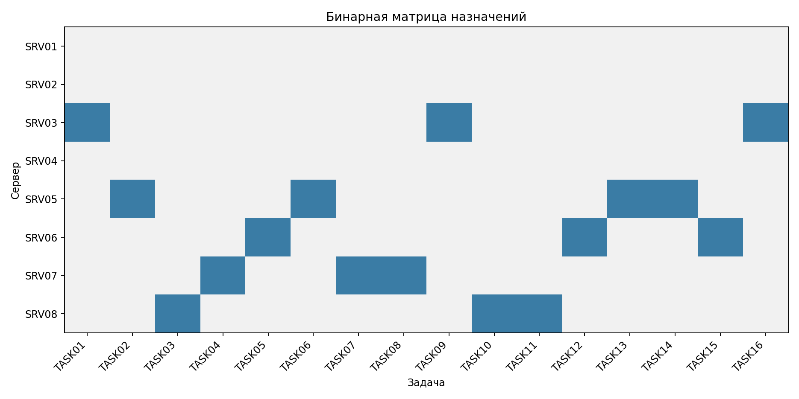
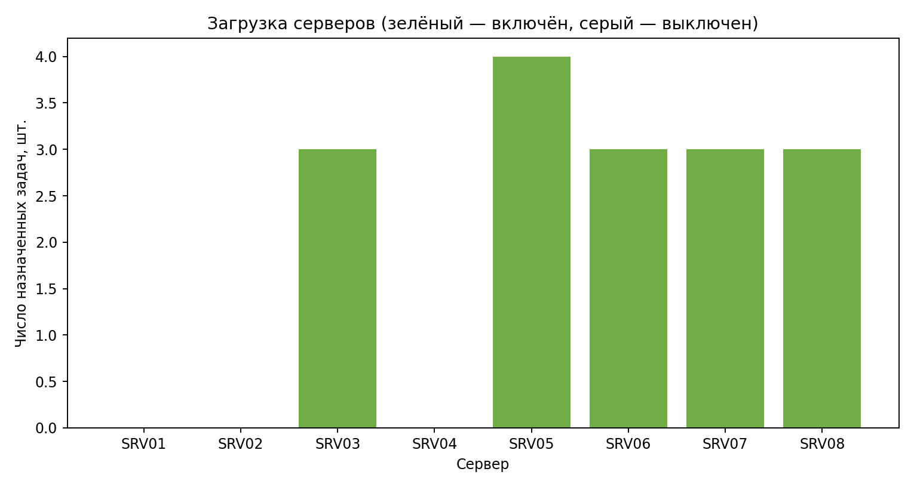
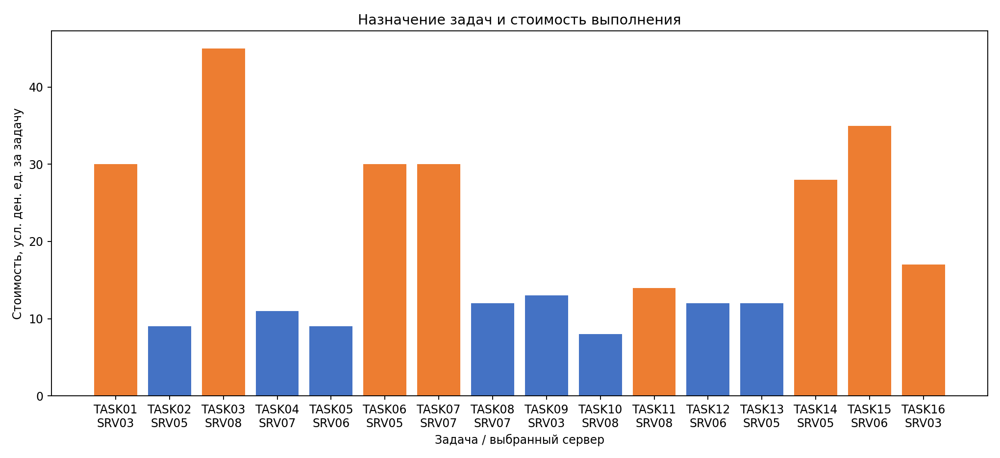
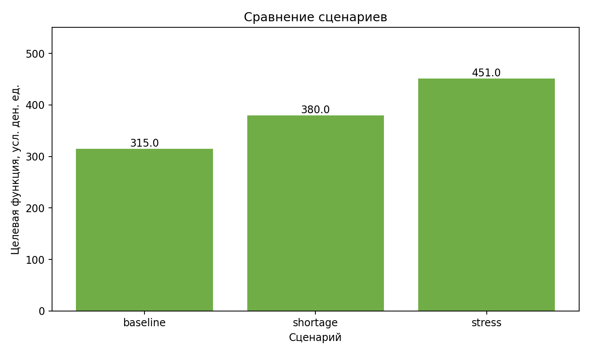
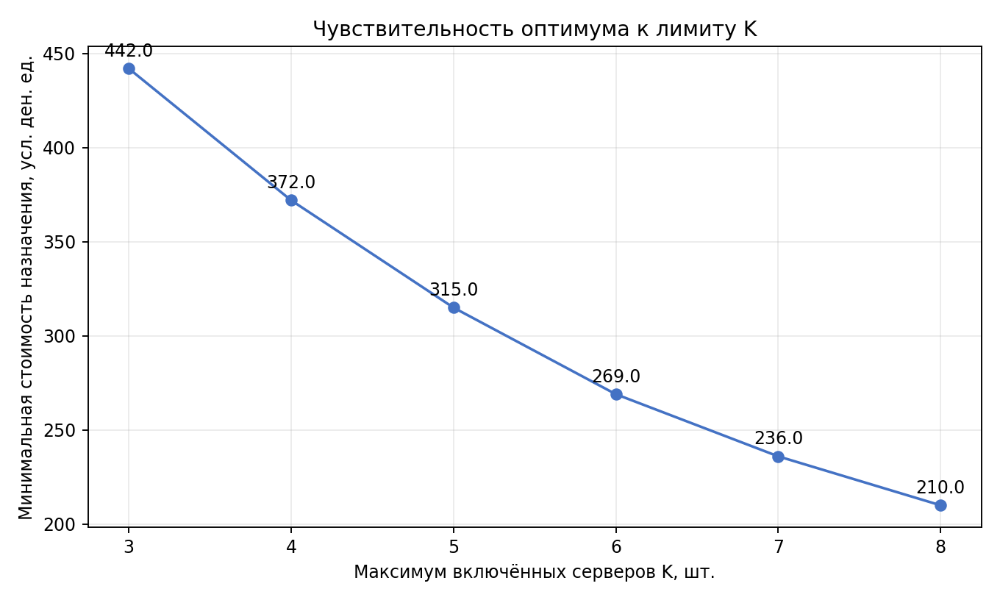

# Лабораторная работа №3 — назначение серверов на задачи

## 1. Титульная информация

**Дисциплина:** Методы оптимизации. Линейное программирование  
**Лабораторная работа:** №3. **Тема:** назначение задач серверам при ограничении числа включённых серверов.  
**Группа:** 517. **Вариант:** 19.  
**Технологии:** Python 3.14.4, NumPy 2.3.3, Pandas 2.3.3, SciPy 1.16.2, HiGHS 1.8.0 через `scipy.optimize.milp`, Matplotlib 3.10.7.

## 2. Цель работы

Построить и решить бинарную MILP-модель назначения вычислительных задач серверам, минимизировать стоимость назначений при ограничении на количество включённых серверов и проверить результат независимым пересчётом.

## 3. Индивидуальный вариант

Индивидуальные параметры: $N=5$, $Q=1$, $Y=26$, группа 517, seed 10105.  
$$V=1+((17N+7Q+Y)\bmod20)=1+((17\cdot5+7\cdot1+26)\bmod20)=19.$$

Вариант 19: назначение серверов на задачи с ограничением числа одновременно включённых серверов.

## 4. Постановка задачи

Имеется 8 доступных серверов и 16 неделимых задач. Каждую задачу нужно целиком назначить одному серверу. Таблица задаёт стоимость выполнения каждой пары. В базовом режиме можно включить не более $K=5$ серверов. Отдельная фиксированная стоимость включения не используется.

## 5. Математическая модель

Множества $I$ и $J$ — серверы и задачи. Параметр $c_{ij}$ — стоимость выполнения задачи $j$ сервером $i$ (условные денежные единицы/задачу); $K$ — предел включённых серверов (шт.); $a_i\in\{0,1\}$ — доступность сервера. Здесь базово $a_i=1$ для всех $i$.

Бинарные переменные:
$$x_{ij}=1\iff\text{задача }j\text{ назначена серверу }i,\qquad
y_i=1\iff\text{сервер }i\text{ включён}.$$

$$\min Z=\sum_{i\in I}\sum_{j\in J}c_{ij}x_{ij}$$

$$\sum_{i\in I}x_{ij}=1\quad(j\in J),\qquad
x_{ij}\le y_i\quad(i\in I,j\in J),\qquad
y_i\le\sum_{j\in J}x_{ij}\quad(i\in I),$$
$$\sum_{i\in I}y_i\le K,\qquad y_i\le a_i\text{ для недоступных серверов},\qquad
x_{ij},y_i\in\{0,1\}.$$

Связь $y_i\le\sum_jx_{ij}$ исключает формальное включение пустых серверов; включённый сервер в решении получает хотя бы одну задачу. Модель — MILP с линейными ограничениями и бинарными переменными, то есть не непрерывная LP.

## 6. Генерация данных

Применён фиксированный `numpy.random.default_rng(10105)`. Для каждой из восьми машин заранее перемешиванием выбиралась пара предпочтительных задач; стоимость этих назначений генерировалась целым числом 8–19, остальные пары — 28–75. Это задаёт разные профили цен без дополнительных ограничений мощности. Все серверы доступны; пары сервер–задача разрешены все. Параметры среды и генерации записаны в `data/generated/generation_metadata.json`. Исходные CSV при повторных запусках сохраняются.

### Серверы

| server_id   | server_name             |   available |
|:------------|:------------------------|------------:|
| SRV01       | Вычислительный сервер 1 |           1 |
| SRV02       | Вычислительный сервер 2 |           1 |
| SRV03       | Вычислительный сервер 3 |           1 |
| SRV04       | Вычислительный сервер 4 |           1 |
| SRV05       | Вычислительный сервер 5 |           1 |
| SRV06       | Вычислительный сервер 6 |           1 |
| SRV07       | Вычислительный сервер 7 |           1 |
| SRV08       | Вычислительный сервер 8 |           1 |

### Задачи

| task_id   | task_name                |
|:----------|:-------------------------|
| TASK01    | Вычислительная задача 1  |
| TASK02    | Вычислительная задача 2  |
| TASK03    | Вычислительная задача 3  |
| TASK04    | Вычислительная задача 4  |
| TASK05    | Вычислительная задача 5  |
| TASK06    | Вычислительная задача 6  |
| TASK07    | Вычислительная задача 7  |
| TASK08    | Вычислительная задача 8  |
| TASK09    | Вычислительная задача 9  |
| TASK10    | Вычислительная задача 10 |
| TASK11    | Вычислительная задача 11 |
| TASK12    | Вычислительная задача 12 |
| TASK13    | Вычислительная задача 13 |
| TASK14    | Вычислительная задача 14 |
| TASK15    | Вычислительная задача 15 |
| TASK16    | Вычислительная задача 16 |

### Матрица стоимости, условные денежные единицы

| server_id   |   TASK01 |   TASK02 |   TASK03 |   TASK04 |   TASK05 |   TASK06 |   TASK07 |   TASK08 |   TASK09 |   TASK10 |   TASK11 |   TASK12 |   TASK13 |   TASK14 |   TASK15 |   TASK16 |
|:------------|---------:|---------:|---------:|---------:|---------:|---------:|---------:|---------:|---------:|---------:|---------:|---------:|---------:|---------:|---------:|---------:|
| SRV01       |       66 |       36 |       65 |       47 |       29 |       14 |       13 |       70 |       49 |       61 |       47 |       75 |       65 |       38 |       31 |       44 |
| SRV02       |       75 |       75 |       19 |       31 |       43 |       61 |       58 |       75 |       32 |       35 |       74 |       39 |       52 |       38 |       15 |       74 |
| SRV03       |       30 |       75 |       48 |       75 |       57 |       73 |       49 |       64 |       13 |       64 |       53 |       72 |       75 |       64 |       66 |       17 |
| SRV04       |       14 |       31 |       60 |       39 |       40 |       52 |       59 |       60 |       48 |       35 |       66 |       55 |       35 |       18 |       69 |       32 |
| SRV05       |       54 |        9 |       63 |       50 |       49 |       30 |       33 |       71 |       75 |       59 |       50 |       41 |       12 |       28 |       38 |       59 |
| SRV06       |       68 |       64 |       64 |       50 |        9 |       32 |       48 |       44 |       75 |       70 |       61 |       12 |       68 |       49 |       35 |       62 |
| SRV07       |       70 |       40 |       46 |       11 |       44 |       58 |       30 |       12 |       73 |       44 |       54 |       61 |       53 |       65 |       53 |       59 |
| SRV08       |       56 |       47 |       45 |       66 |       38 |       62 |       62 |       36 |       56 |        8 |       14 |       44 |       37 |       43 |       48 |       59 |

Базовый сценарий использует $K=5$, что меньше восьми серверов. Он допустим: все задачи назначаемы на каждый доступный сервер, а $K\ge1$.

## 7. Программная реализация

`data_generation.py` генерирует данные; `data_loader.py` проверяет CSV; `model.py` строит матрицу ограничений и векторы MILP; `solver.py` вызывает HiGHS и сохраняет статистику; `validation.py` загружает сохранённые $x,y$ и перепроверяет модель через NumPy; `experiments.py` выполняет сценарии и перебор K; `reporting.py` строит графики и этот отчёт; `run.py` связывает этапы. Порядок переменных зафиксирован: сначала все $x_{ij}$ в порядке серверов, затем задач, затем все $y_i$ в порядке серверов.

## 8. Настройки решателя

Используется `scipy.optimize.milp` с HiGHS. Явно переданы `disp=False`, `presolve=True`, `mip_rel_gap=0.0`; лимиты времени и узлов не задавались. Границы всех переменных — [0,1], `integrality=1` для каждой переменной. Статусы SciPy: 0 — доказанный оптимум; 1 — достигнут лимит; 2 — задача несовместна; 3 — неограниченность; 4 — другая ошибка. Целевой оптимум записывается только при статусе 0. Поля MIP gap/node count читаются только если их вернул интерфейс.

## 9. Результаты базового сценария

Статус: **optimal** — Optimization terminated successfully. (HiGHS Status 7: Optimal). Целевая функция: **315.000000** условных денежных единиц; время решения 0.007429 с; MIP gap: 0.0; узлы: 1. Включено 5 серверов из лимита 5; осталось свободных мест по лимиту 0.

Включённые серверы:

| server_id   | server_name             |   assigned_tasks |   assignment_cost |
|:------------|:------------------------|-----------------:|------------------:|
| SRV03       | Вычислительный сервер 3 |                3 |            60.000 |
| SRV05       | Вычислительный сервер 5 |                4 |            79.000 |
| SRV06       | Вычислительный сервер 6 |                3 |            56.000 |
| SRV07       | Вычислительный сервер 7 |                3 |            53.000 |
| SRV08       | Вычислительный сервер 8 |                3 |            67.000 |

Выключенные серверы:

| server_id   | server_name             |   assigned_tasks |
|:------------|:------------------------|-----------------:|
| SRV01       | Вычислительный сервер 1 |                0 |
| SRV02       | Вычислительный сервер 2 |                0 |
| SRV04       | Вычислительный сервер 4 |                0 |

Распределение задач по серверам:

| server_id   | server_name             | tasks                          |   task_count |   total_cost |
|:------------|:------------------------|:-------------------------------|-------------:|-------------:|
| SRV03       | Вычислительный сервер 3 | TASK01, TASK09, TASK16         |            3 |       60.000 |
| SRV05       | Вычислительный сервер 5 | TASK02, TASK06, TASK13, TASK14 |            4 |       79.000 |
| SRV06       | Вычислительный сервер 6 | TASK05, TASK12, TASK15         |            3 |       56.000 |
| SRV07       | Вычислительный сервер 7 | TASK04, TASK07, TASK08         |            3 |       53.000 |
| SRV08       | Вычислительный сервер 8 | TASK03, TASK10, TASK11         |            3 |       67.000 |

Назначения всех задач с их стоимостью сохранены в `results/baseline/assignment_plan.csv`.

## 10. Независимая проверка

Проверяющий код читает исходные CSV и сохранённый `variable_values.csv`; объект HiGHS и матрицы из модели не используются. Пересчитаны единственность назначения, связь $x\le y$, отсутствие пустых включённых серверов, K, доступность, бинарность и цель. Статус: **пройдена**; ограничений/проверок 35; нарушений 0; максимальная невязка 0.000e+00; независимая цель 315.000000000; расхождение с MILP 0.000e+00.

## 11. Дефицитный сценарий

Лимит снижен до $K=4$, сервер(а) SRV05 отключён(ы). Статус optimal; стоимость 380.000000 усл. ден. ед.. По сравнению с базой изменение составляет +65.000000 усл. ден. ед.. Переназначено задач: 14.

| task_id   | server_id_base   | server_id_short   |
|:----------|:-----------------|:------------------|
| TASK01    | SRV03            | SRV04             |
| TASK02    | SRV05            | SRV04             |
| TASK03    | SRV08            | SRV02             |
| TASK04    | SRV07            | SRV02             |
| TASK05    | SRV06            | SRV01             |
| TASK06    | SRV05            | SRV01             |
| TASK07    | SRV07            | SRV01             |
| TASK08    | SRV07            | SRV08             |
| TASK09    | SRV03            | SRV02             |
| TASK12    | SRV06            | SRV02             |
| TASK13    | SRV05            | SRV04             |
| TASK14    | SRV05            | SRV04             |
| TASK15    | SRV06            | SRV02             |
| TASK16    | SRV03            | SRV04             |

## 12. Стрессовый сценарий

Лимит снижен до $K=3$ и недоступны серверы: SRV05, SRV03. Это два одновременных ухудшения. Статус optimal; целевая функция 451.000000 усл. ден. ед.. Число доступных серверов остаётся 6, поэтому при $K\ge1$ задачи можно назначить. Переназначено задач относительно базы: 13.

| task_id   | server_id_base   | server_id_stress   |
|:----------|:-----------------|:-------------------|
| TASK01    | SRV03            | SRV04              |
| TASK02    | SRV05            | SRV04              |
| TASK04    | SRV07            | SRV04              |
| TASK05    | SRV06            | SRV01              |
| TASK06    | SRV05            | SRV01              |
| TASK07    | SRV07            | SRV01              |
| TASK08    | SRV07            | SRV08              |
| TASK09    | SRV03            | SRV04              |
| TASK12    | SRV06            | SRV08              |
| TASK13    | SRV05            | SRV04              |
| TASK14    | SRV05            | SRV04              |
| TASK15    | SRV06            | SRV01              |
| TASK16    | SRV03            | SRV04              |

Сравнительная таблица основных сценариев:

| scenario   | solver_status   |   objective_value |   number_of_servers |   number_of_tasks |   activation_limit |   enabled_servers |   disabled_servers |   total_assignment_cost |   total_activation_cost |   solve_time |   mip_gap | independent_validation_passed   |
|:-----------|:----------------|------------------:|--------------------:|------------------:|-------------------:|------------------:|-------------------:|------------------------:|------------------------:|-------------:|----------:|:--------------------------------|
| baseline   | optimal         |           315.000 |                   8 |                16 |                  5 |                 5 |                  3 |                 315.000 |                   0.000 |        0.007 |     0.000 | True                            |
| shortage   | optimal         |           380.000 |                   8 |                16 |                  4 |                 4 |                  4 |                 380.000 |                   0.000 |        0.012 |     0.000 | True                            |
| stress     | optimal         |           451.000 |                   8 |                16 |                  3 |                 3 |                  5 |                 451.000 |                   0.000 |        0.011 |     0.000 | True                            |

## 13. Анализ влияния лимита K

Модель повторно решалась для каждого K от 3 до 8. При увеличении K допустимое множество расширяется, поэтому минимальная стоимость не должна возрастать. Автоматическая проверка монотонности пройдена.

|   activation_limit | solver_status   |   objective_value |   enabled_servers |   solve_time |   mip_gap | independent_validation_passed   |
|-------------------:|:----------------|------------------:|------------------:|-------------:|----------:|:--------------------------------|
|                  3 | optimal         |           442.000 |                 3 |        0.024 |     0.000 | True                            |
|                  4 | optimal         |           372.000 |                 4 |        0.013 |     0.000 | True                            |
|                  5 | optimal         |           315.000 |                 5 |        0.004 |     0.000 | True                            |
|                  6 | optimal         |           269.000 |                 6 |        0.004 |     0.000 | True                            |
|                  7 | optimal         |           236.000 |                 7 |        0.004 |     0.000 | True                            |
|                  8 | optimal         |           210.000 |                 8 |        0.004 |     0.000 | True                            |

Если при увеличении K целевая функция снижается, это отражает возможность оставить специализированные серверы включёнными и направить на них подходящие задачи. Плато означает, что дополнительный сервер не улучшает выбранное распределение.

## 14. Анализ выбранных серверов

Выбранные машины позволяют минимизировать суммарную стоимость по набору всех задач, а не только одну локальную цену. У каждого включённого сервера есть хотя бы одно назначение; остальные выключены и не учитываются в лимите. Таблица загрузки и матрица назначения показывают, какие задачи используют преимущество конкретных серверов. Фиксированные затраты включения равны нулю, поэтому компромисс формируется стоимостью назначения и лимитом K.

## 15. Ограничения модели и допущения

Каждая задача неделима и назначается ровно одному серверу. Сервер считается включённым тогда и только тогда, когда на него назначена хотя бы одна задача. Затраты — условные; фиксированной платы включения нет. Модель не учитывает вычислительную мощность, память, параллелизм, длительность, расписание, сетевую задержку и пропускную способность. Эти ограничения не вводились, поскольку для выбранной постановки нет соответствующих исходных параметров.

## 16. Выводы

Для варианта 19 построена MILP-модель с бинарным назначением задач и включением серверов. Решение обязано выбирать компромисс между специализированными ценами и лимитом активных машин. Дефицитный и стрессовый сценарии моделируют сокращение доступной инфраструктуры, а перебор K количественно показывает влияние лимита. Независимая проверка использует сохранённые переменные и исходные CSV.

## Запуск

Из каталога `lr-3`: `python -m pip install -r requirements.txt`, затем `python run.py`. Отчёт находится в `reports/report.md`, графики — в `plots/`, подробные сценарные результаты — в `results/`, журнал — в `logs/solver.log`.
